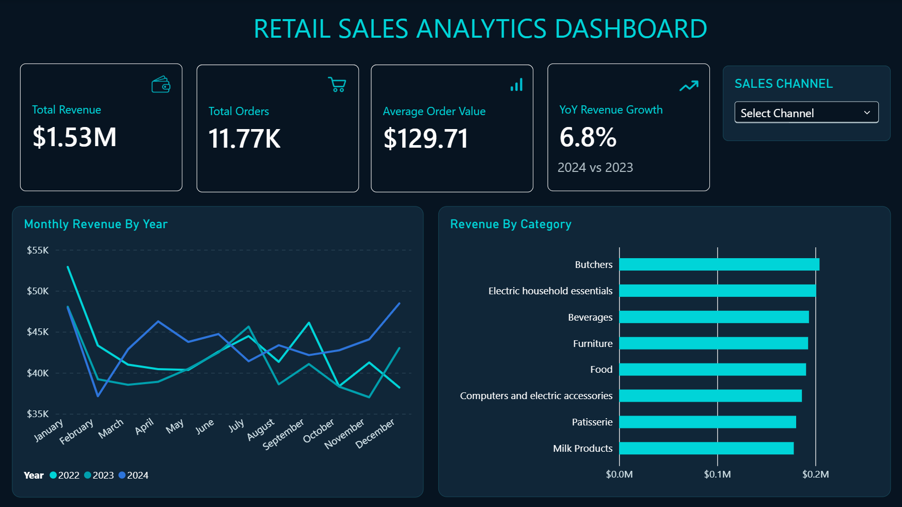

# Retail Sales Analytics Dashboard: Power BI

An interactive, one-page Power BI dashboard that turns a cleaned retail sales dataset into a quick, readable view of revenue, orders, growth, category performance and seasonal trends. It uses a custom dark theme with teal accents and icon-based KPI cards.

> **Data source:** the cleaned output of my Python project: [Retail-Sales-Cleaning-Analysis](https://github.com/abdulrehman-DA/Retail-Sales-Cleaning-Analysis)

## Dashboard Preview

## What the Dashboard Shows

| Visual | What it answers |
|---|---|
| **Total Revenue** (card) | How much was sold overall |
| **Total Orders** (card) | How many orders were placed |
| **Average Order Value** (card) | Average spend per order |
| **YoY Revenue Growth** (card) | How much revenue grew in 2024 compared with 2023 |
| **Monthly Revenue By Year** (line chart) | How revenue moves through the year, with one line per year to compare seasonal patterns |
| **Revenue By Category** (bar chart) | Which product categories bring in the most revenue |
| **Sales Channel** (dropdown filter) | Filters every visual by Online or In-store |

## Key Observations

- Total revenue is about $1.53M across roughly 11.77K orders, with an average order value of about $129.71.
- Revenue grew about 6.8% in 2024 compared with 2023.
- January starts strong in all three years, followed by a dip in February.
- Butchers is the top category by revenue, and Milk Products is the lowest, though the categories are close together.

## Skills Demonstrated

- Importing and preparing a CSV in Power BI (data types and date fields)
- Writing DAX measures for Total Orders, Average Order Value and YoY Revenue Growth
- Line, bar and card visuals, with the line chart split by year to compare seasonality
- A dropdown slicer with cross-filtering, so one selection updates every visual
- Dashboard design: custom dark theme, consistent color palette, icons and a clear layout

## Notes

- 2025 is excluded with a page-level filter because the dataset only contains partial January data for that year, which would make the trend look like a decline.
- The data comes from my Python cleaning project, where missing values were handled before the data was loaded into Power BI.

## Files

- `retail_sales_dashboard.pbix`: the Power BI file (open with Power BI Desktop)
- `dashboard_screenshot.png`: preview image of the dashboard

## Tools Used

Power BI Desktop, DAX
